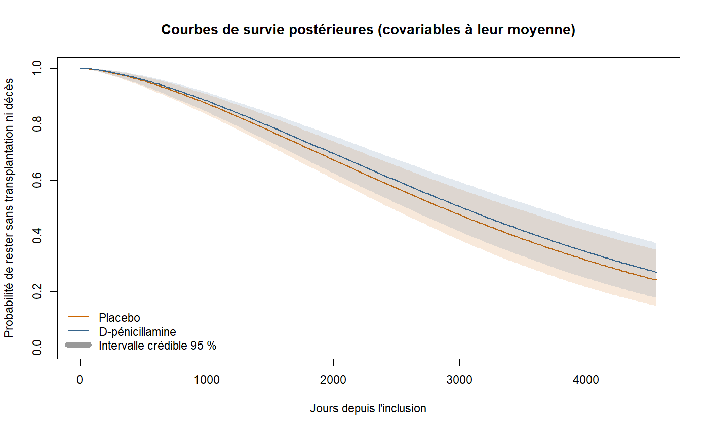

# Modélisation bayésienne de la survie avec R et Stan

Analyse reproductible d'un essai historique de cholangite biliaire primitive :
modèle paramétrique Weibull AFT, censure à droite et estimation bayésienne
avec **RStan**.

## Question

Chez des patients atteints de cholangite biliaire primitive (PBC) inclus dans
un essai historique, comment les caractéristiques initiales et le traitement
par D-pénicillamine sont-ils associés au temps avant transplantation hépatique
ou décès ?

Le résultat est un exercice de biostatistique sur des données historiques
agrégées. Il ne permet pas de recommandation thérapeutique ni d'inférence
causale clinique à lui seul.

## Données et définition de l'événement

Le projet utilise le jeu `pbc` fourni par le package R `survival`; aucun fichier
de données patient n'est copié dans ce dépôt. La documentation du package
indique que les 312 premières personnes ont participé à l'essai randomisé
D-pénicillamine contre placebo. Les autres personnes n'ont pas été randomisées :
elles sont donc exclues de l'analyse principale.

La variable `status` vaut 0 pour une observation censurée, 1 pour une
transplantation et 2 pour un décès. L'événement étudié est le critère composite
« transplantation ou décès » (`status > 0`) ; les deux résultats sont donc
comptés comme événements. Les observations `status == 0` contribuent à la
vraisemblance de survie censurée à droite.

Le temps est mesuré depuis l'inclusion jusqu'au premier de ces événements ou
jusqu'à la dernière observation. Les variables d'ajustement sont l'âge, le
logarithme de la bilirubine sérique, l'albumine sérique et le groupe de
traitement. Les trois variables continues sont centrées-réduites ; le
traitement est codé 1 pour D-pénicillamine et 0 pour placebo.

## Modèle

Le modèle paramétrique Weibull AFT (Accelerated Failure Time) s'écrit :

```text
T_i ~ Weibull(shape, scale_i)
log(scale_i) = alpha + X_i beta
```

La contribution à la vraisemblance est la densité Weibull pour un événement
observé et la fonction de survie pour une observation censurée. La censure est
donc traitée dans le modèle, et non convertie en échec ou en événement.

Les coefficients continus décrivent le changement du logarithme du temps
caractéristique associé à une hausse d'un écart-type du prédicteur. Le
coefficient du traitement est exponentié : son `time ratio` compare le temps
caractéristique sous D-pénicillamine au placebo, à covariables égales. Une valeur
supérieure à 1 correspond à un temps caractéristique plus long dans ce modèle ;
l'intervalle crédible et les diagnostics doivent être examinés avant toute
interprétation. Les a priori sont `normal(0, 1)` sur les coefficients,
`normal(log(2000), 1.5)` sur l'intercept et `lognormal(log(1.5), 0.5)` sur la
forme Weibull.

## Installation et exécution

R, un compilateur C++ (Rtools sous Windows), `rstan` et `survival` sont
nécessaires. Dans une session R :

```r
install.packages(c("rstan", "survival"))
```

Puis, depuis le dossier `PBC_RStan_Bayes` :

```powershell
Rscript fit_model.R
```

Par défaut, 4 chaînes sont lancées avec 2 000 itérations chacune, dont 1 000
itérations de warmup. Les chemins Stan et résultats sont calculés depuis le
script ; il peut donc aussi être lancé depuis un autre dossier en donnant son
chemin absolu. Les paramètres peuvent être réglés :

```powershell
Rscript fit_model.R --iter 3000 --warmup 1500 --seed 2026 --output-dir outputs
```

La première exécution compile le modèle Stan et peut prendre plusieurs minutes.
Pour une analyse montrable, conserve les valeurs par défaut et la graine
enregistrée dans les métadonnées.

## Livrables

Le dossier `results/` contient les résultats lisibles à partager :

- `posterior_parameter_estimates.csv` : moyenne, écart-type, médiane, intervalle
  crédible à 95 %, R-hat et taille d'échantillon effective reportée par RStan ;
- `model_diagnostics.csv` : transitions divergentes, hits de profondeur maximale,
  R-hat maximum et taille d'échantillon effective minimale ;
- `analysis_metadata.csv` : versions des paquets, graine, paramètres de simulation
  et comptage des observations ;
- `posterior_survival_curves.png` : courbes postérieures par traitement pour
  les covariables fixées à leur moyenne, avec intervalles crédibles à 95 % ;

L'objet complet ajusté (`pbc_weibull_fit.rds`) est généré pour l'analyse locale,
mais exclu du contrôle de version : les CSV et le graphique suffisent pour
consulter les résultats et gardent le dépôt plus léger.

### Courbes postérieures



## Résultat de l'exécution de référence

Avec R 4.4.0, `rstan` 2.32.6, quatre chaînes, 2 000 itérations par chaîne et
1 000 itérations de warmup, le modèle a été compilé et exécuté sur les 312
participants randomisés (144 événements composites, 168 censures).

| Paramètre | Médiane postérieure | Intervalle crédible à 95 % |
|---|---:|---:|
| Rapport de temps D-pénicillamine / placebo | 1,06 | [0,85 ; 1,31] |
| Âge, par écart-type | -0,15 | [-0,26 ; -0,05] |
| Log-bilirubine, par écart-type | -0,62 | [-0,74 ; -0,51] |
| Albumine, par écart-type | 0,28 | [0,17 ; 0,39] |
| Forme Weibull | 1,55 | [1,36 ; 1,77] |

Dans cette exécution, le rapport de temps du traitement a un intervalle crédible
qui contient 1 : cette analyse ne met donc pas en évidence une différence
claire du temps caractéristique entre les groupes. Les associations des
biomarqueurs sont conditionnelles au modèle et ne doivent pas être interprétées
comme des effets causaux.

Les diagnostics enregistrés indiquent un R-hat maximal de 1,0008, une taille
d'échantillon effective minimale d'environ 2 826, aucune transition divergente et aucun dépassement de
la profondeur maximale avec les paramètres de référence. Ces diagnostics
évaluent l'échantillonnage, pas la validité clinique ou la qualité de la forme
Weibull.

## Contrôles et limites

Vérifier notamment R-hat proche de 1, ESS suffisant, absence de transitions
divergentes et l'absence de saturations de profondeur maximale. Ces contrôles
ne prouvent pas à eux seuls que le modèle est bien spécifié.

Ce projet constitue une analyse pédagogique. Le modèle Weibull impose une forme
paramétrique aux temps d'événement ; les résultats devraient être confrontés à
des analyses de sensibilité, à des contrôles prédictifs postérieurs et à un
modèle de référence. Les courbes postérieures générées sont des estimations
conditionnelles au modèle, pas un contrôle prédictif postérieur complet.
Transplantation et décès sont regroupés en un critère
composite : le modèle ne traite pas séparément les risques compétitifs. L'essai
est historique, de taille limitée, et le modèle ajusté n'est pas une évaluation
clinique de l'efficacité du traitement.

## Source des données

Therneau, T. M. et Grambsch, P. M. (2000), *Modeling Survival Data: Extending
the Cox Model*, Springer. La description, les définitions de `status` et
`time`, et la sélection des 312 participants randomisés sont documentées dans
[`survival::pbc`](https://stat.ethz.ch/R-manual/R-devel/library/survival/html/pbc.html).

Le jeu est chargé depuis le package R `survival` à l'exécution ; aucun CSV
individuel n'est embarqué dans ce projet. Avant de republier ou de réutiliser les
données ou des dérivés sur une plateforme publique, vérifie les conditions
d'utilisation applicables au jeu et cite sa source. Le dépôt contient les
paramètres agrégés du modèle, des diagnostics et une figure, pas le fichier
individuel ni l'objet RStan sérialisé.

## Présentation publique

Pour GitHub, publie le dossier du projet avec `README.md`, `fit_model.R`,
`stan/pbc_weibull_aft.stan` et les quatre fichiers sélectionnés de `results/`.
Le dossier `outputs/`, les caches compilés et les objets `.rds` sont exclus par
`.gitignore`. Ne présente pas cette analyse comme une preuve de l'efficacité du
traitement : l'intervalle crédible du rapport de temps contient 1 et le projet
est pédagogique.
