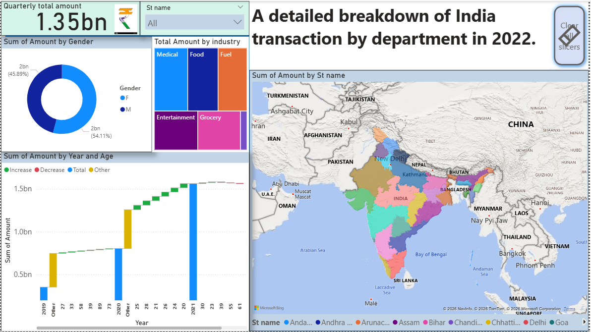
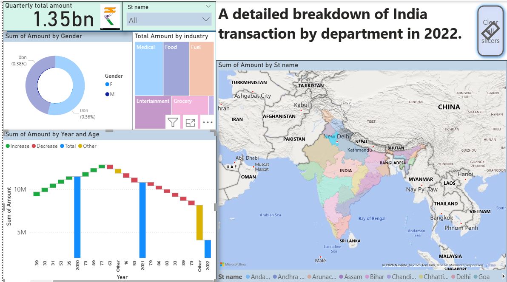

# Analyse des transactions en Inde — tableau de bord Power BI

Ce projet présente un tableau de bord interactif réalisé avec Power BI pour
explorer des transactions par secteur d'activité et par État en Inde.

## Aperçu

Le rapport propose notamment :

- un montant total agrégé, avec un filtre par État ;
- une répartition des montants par secteur d'activité et par genre ;
- une visualisation géographique par État indien ;
- une analyse des montants par année et par âge.

Les valeurs affichées dépendent des filtres du rapport. Avant de tirer des
conclusions, il faut vérifier la définition des indicateurs, la période et
l'unité monétaire dans les données et le modèle.

## Fichiers

- `India_transactions_Asia.pbix` : rapport Power BI à ouvrir avec Power BI
  Desktop.
- `images/` : captures d'écran du rapport.

## Compétences mobilisées

Conception et optimisation d’un rapport Power BI orienté métier, puis automatisation de son actualisation à l’aide de Power Automate.
